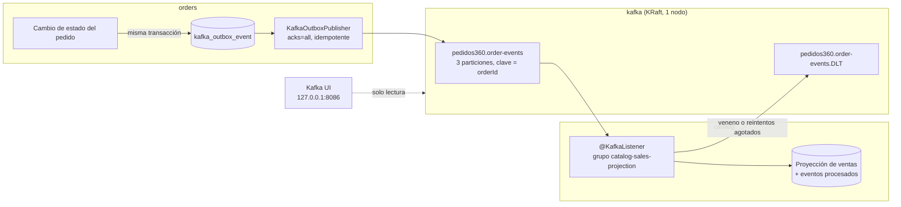

# Mensajería con Kafka

Eventos de dominio de los pedidos: `orders` publica cada cambio de un pedido en Kafka y `catalog` los consume para mantener una proyección de ventas por producto. Kafka convive con RabbitMQ; no lo reemplaza.

## Por qué Kafka además de RabbitMQ

Los dos brokers resuelven problemas distintos:

| | RabbitMQ (`docs/MENSAJERIA_RABBITMQ.md`) | Kafka (este documento) |
|---|---|---|
| Qué transporta | **Comandos**: "reservá stock para este pedido" | **Eventos**: "este pedido pasó a ACEPTADO" |
| Destinatario | Un consumidor concreto que debe actuar | Cualquier interesado, hoy o en el futuro |
| Qué pasa con el mensaje consumido | Se borra de la cola al hacer `ack` | Queda en el log hasta que vence la retención (7 días por defecto) |
| Releer el pasado | No: lo consumido ya no existe | Sí: se mueve el offset del grupo y se vuelve a procesar (*replay*) |
| Varios lectores | Una cola por consumidor, con bindings | Cada **consumer group** lee el tópico entero con su propio offset |
| Orden | Por cola; entre colas no hay orden | Por partición; con la clave `orderId` todos los eventos de un pedido van en orden |

La reserva de stock sigue en RabbitMQ: necesita reintentos con retardo, DLQ por cola y una respuesta (`stock.reservado` / `stock.reserva-fallida`). Los eventos de dominio van a Kafka porque son un historial que otros servicios pueden leer, y releer, sin que `orders` sepa quiénes son.

## Flujo



## Contrato de eventos

| Elemento | Valor |
|---|---|
| Tópico | `pedidos360.order-events` (3 particiones, factor de replicación 1) |
| Clave del registro | `orderId` como texto: todos los eventos de un pedido caen en la misma partición y se leen en orden |
| Valor | JSON (abajo) |
| Tópico de errores | `pedidos360.order-events.DLT` (3 particiones) |
| Grupo de catalog | `catalog-sales-projection` |
| Publica | `orders`, desde la outbox `kafka_outbox_event` |
| Consume | `catalog` |

```json
{
  "eventId": "uuid",
  "eventType": "ORDER_CREATED | ORDER_UPDATED | ORDER_ACCEPTED | ORDER_IN_PREPARATION | ORDER_DISPATCHED | ORDER_DELIVERED | ORDER_CANCELLED",
  "schemaVersion": 1,
  "orderId": "uuid",
  "status": "CREADO | ACEPTADO | EN_PREPARACION | DESPACHADO | ENTREGADO | CANCELADO",
  "previousStatus": "mismo enum o null (null en ORDER_CREATED)",
  "items": [{ "productId": "uuid", "quantity": 1 }],
  "occurredAt": "instante ISO-8601 en UTC"
}
```

| `eventType` | Cuándo lo emite `orders` | Efecto en la proyección de `catalog` |
|---|---|---|
| `ORDER_CREATED` | Al crear el pedido | Ninguno |
| `ORDER_UPDATED` | Al editar el pedido | Ninguno |
| `ORDER_ACCEPTED` | `→ ACEPTADO` | `unitsSold += quantity` |
| `ORDER_IN_PREPARATION` | `→ EN_PREPARACION` | Ninguno |
| `ORDER_DISPATCHED` | `→ DESPACHADO` | Ninguno |
| `ORDER_DELIVERED` | `→ ENTREGADO` | `unitsDelivered += quantity` |
| `ORDER_CANCELLED` | `→ CANCELADO`, también por stock rechazado | `unitsCancelled += quantity` si `previousStatus` es `ACEPTADO`, `EN_PREPARACION` o `DESPACHADO`; desde `CREADO`, ninguno |

Cambiar un campo, un `eventType` o el nombre del tópico en un servicio sin cambiar el otro deja eventos en la DLT. Un cambio incompatible exige subir `schemaVersion`: hoy `catalog` envía a la DLT todo evento con `schemaVersion` distinto de `1`.

## Garantías

| Garantía | Cómo se obtiene |
|---|---|
| No se pierde un evento | Outbox `kafka_outbox_event` en la misma transacción que el cambio del pedido. El publicador marca la fila como publicada sólo después del ack del broker (`acks=all`). Sin broker, el evento queda pendiente y se reintenta en cada ciclo. |
| Orden por pedido | Las filas se publican por `created_at` y el lote se corta en el primer fallo; la clave `orderId` las manda a la misma partición. Productor idempotente: un reintento interno no duplica ni reordena. |
| Entrega at-least-once | Un crash entre el ack y el marcado reenvía el evento. |
| Un duplicado no tiene efecto | `catalog` registra cada `eventId` procesado en la misma transacción que actualiza los contadores; un evento repetido no cambia nada. |
| Nada se descarta en silencio | JSON ilegible, `eventType` desconocido o `schemaVersion` ≠ 1 van a la DLT sin reintentos; un fallo transitorio se reintenta con backoff y, agotado, también va a la DLT. |

## Infraestructura local

`docker-compose.yml` agrega tres servicios:

| Servicio | Imagen | Rol |
|---|---|---|
| `kafka` | `apache/kafka:4.3.2` | Broker y controller en un solo proceso (KRaft, sin ZooKeeper). Sólo en la red `backend`; el puerto 9092 no se publica al host. Datos en el volumen `pedidos360_kafka-data`. |
| `kafka-init` | `apache/kafka:4.3.2` | Tarea única: crea los dos tópicos con `--if-not-exists` y termina con código 0. Es idempotente: cada `up` puede volver a correrla. |
| `kafka-ui` | `kafbat/kafka-ui:v1.5.0` | Consola web en **modo sólo lectura**, publicada sólo en `127.0.0.1:${KAFKA_UI_PORT:-8086}`. |

Detalles de configuración:

- **Listener anunciado `kafka:9092`**: los clientes dentro de la red de Compose llegan al broker por el nombre del servicio. Desde el host no hay acceso directo al broker; se usa `docker compose exec` o la Kafka UI.
- **Auto-creación de tópicos desactivada** (`KAFKA_AUTO_CREATE_TOPICS_ENABLE=false`): un nombre de tópico mal escrito falla en vez de crear en silencio un tópico vacío. Los tópicos los crea sólo `kafka-init`.
- **Arranque**: `catalog` y `orders` esperan a que `kafka-init` termine bien (`service_completed_successfully`), y `kafka-init` espera a que `kafka` esté sano.
- `catalog` y `orders` reciben `SPRING_KAFKA_BOOTSTRAP_SERVERS=kafka:9092`. Fuera de Docker (perfil `local`), su valor por defecto es `localhost:9092`.

Variables opcionales en `.env` (tienen valor por defecto):

```dotenv
# --- Kafka ---
KAFKA_UI_PORT=8086
# Sólo para formatear un volumen nuevo; base64 de un UUID (kafka-storage.sh random-uuid).
KAFKA_CLUSTER_ID=lt4pMihWTs2WdoOIy9jBqg
```

> `KAFKA_CLUSTER_ID` queda grabado en el volumen al formatearlo. Cambiarlo con un volumen existente impide que el broker arranque: hay que volver al valor anterior o recrear el volumen `pedidos360_kafka-data`.

## Cómo verificar

Levantar sólo Kafka:

```bash
docker compose up -d kafka kafka-init kafka-ui
docker compose ps kafka kafka-init kafka-ui   # kafka healthy, kafka-init Exited (0), kafka-ui healthy
```

Tópicos y particiones:

```bash
docker compose exec kafka /opt/kafka/bin/kafka-topics.sh --bootstrap-server localhost:9092 --list
docker compose exec kafka /opt/kafka/bin/kafka-topics.sh --bootstrap-server localhost:9092 \
  --describe --topic pedidos360.order-events          # PartitionCount: 3
```

Ver los eventos con su clave (`orderId`) y su partición:

```bash
docker compose exec kafka /opt/kafka/bin/kafka-console-consumer.sh --bootstrap-server kafka:9092 \
  --topic pedidos360.order-events --from-beginning \
  --formatter-property print.key=true --formatter-property print.partition=true
```

El mismo comando con `--topic pedidos360.order-events.DLT` muestra los eventos rechazados. Los logs de `catalog` explican el motivo de cada envío a la DLT.

Estado del grupo de catalog (offset y lag por partición):

```bash
docker compose exec kafka /opt/kafka/bin/kafka-consumer-groups.sh --bootstrap-server kafka:9092 \
  --describe --group catalog-sales-projection
```

### Kafka UI

`http://127.0.0.1:8086`: tópicos, mensajes (clave, partición, offset, JSON), consumer groups y lag. Está en modo sólo lectura: no borra tópicos ni mueve offsets. En el servidor, por un túnel SSH:

```bash
ssh -i <llave> -L 8086:127.0.0.1:8086 ubuntu@<host>
```

### Replay: volver a procesar el historial

Kafka conserva los eventos ya consumidos, así que la proyección se puede reconstruir moviendo el offset del grupo. El grupo debe estar **inactivo**: primero se detiene `catalog`.

```bash
docker compose stop catalog
# Ver qué haría, sin cambiar nada:
docker compose exec kafka /opt/kafka/bin/kafka-consumer-groups.sh --bootstrap-server kafka:9092 \
  --group catalog-sales-projection --topic pedidos360.order-events --reset-offsets --to-earliest --dry-run
# Aplicar:
docker compose exec kafka /opt/kafka/bin/kafka-consumer-groups.sh --bootstrap-server kafka:9092 \
  --group catalog-sales-projection --topic pedidos360.order-events --reset-offsets --to-earliest --execute
docker compose start catalog
```

Como `catalog` registra los `eventId` ya aplicados, un replay sobre la misma base **no** vuelve a sumar. Para reconstruir la proyección desde cero hay que vaciar antes sus tablas (contadores y eventos procesados). Sólo se puede reprocesar lo que sigue dentro de la retención (7 días por defecto).

## Seguridad

- El puerto del broker (9092) y el del controller (9093) no se publican al host: sólo son accesibles en la red interna `backend`.
- La Kafka UI no tiene autenticación propia: se publica sólo en `127.0.0.1` y en modo sólo lectura. Como Docker no publica puertos de un contenedor atado únicamente a redes `internal: true`, la UI está también en `egress`; el broker no.
- Sin TLS ni SASL: el tráfico no sale de la red de Docker. En un entorno compartido habría que activar SASL/SCRAM o mTLS y ACLs por servicio.

## Verificación realizada

2026-11-05, proyecto de Compose aislado, sólo `kafka`, `kafka-init` y `kafka-ui`:

| Escenario | Resultado |
|---|---|
| Arranque desde volumen vacío | `kafka` healthy, `kafka-init` `Exited (0)`, `kafka-ui` healthy |
| `--describe` de `pedidos360.order-events` | `PartitionCount: 3`, `ReplicationFactor: 1` |
| `--list` | `pedidos360.order-events` y `pedidos360.order-events.DLT` |
| `kafka-init` ejecutado otra vez | Termina con código 0, sin errores (`--if-not-exists`) |
| Producir y consumir un registro con clave en un tópico de prueba | Se lee `order-1	hello-kafka` |
| Reset de offsets de un grupo (`--dry-run` y `--execute`) | Offset vuelve a 0 |
| Puerto de la UI | Sólo `127.0.0.1:8086` |

No se verificó en este documento el flujo completo `orders → Kafka → catalog` con los servicios levantados: lo cubren los tests de cada repositorio.

## Limitaciones conocidas

- **Un solo broker.** Factor de replicación 1: si `kafka` cae, `orders` acumula los eventos en su outbox y `catalog` deja de actualizar la proyección hasta que vuelve; si se pierde el volumen, se pierde el historial. Alcanza para uso local y académico. En producción: al menos 3 brokers, `replication.factor=3` y `min.insync.replicas=2`.
- **3 particiones fijas.** Limitan a 3 el paralelismo de un grupo. Aumentarlas cambia la partición de cada `orderId` y rompe el orden de los pedidos en curso.
- **Retención por tiempo.** El replay sólo alcanza los últimos 7 días (valor por defecto del broker).
- **Despliegue en EC2 pendiente**, igual que RabbitMQ: el broker suma un contenedor con 512 MB de heap.
